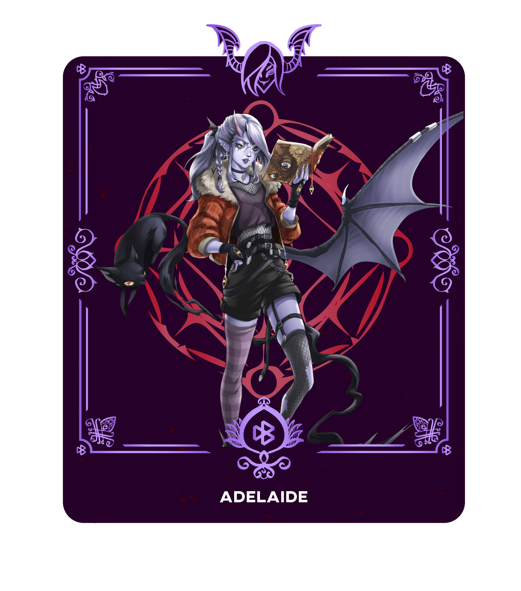
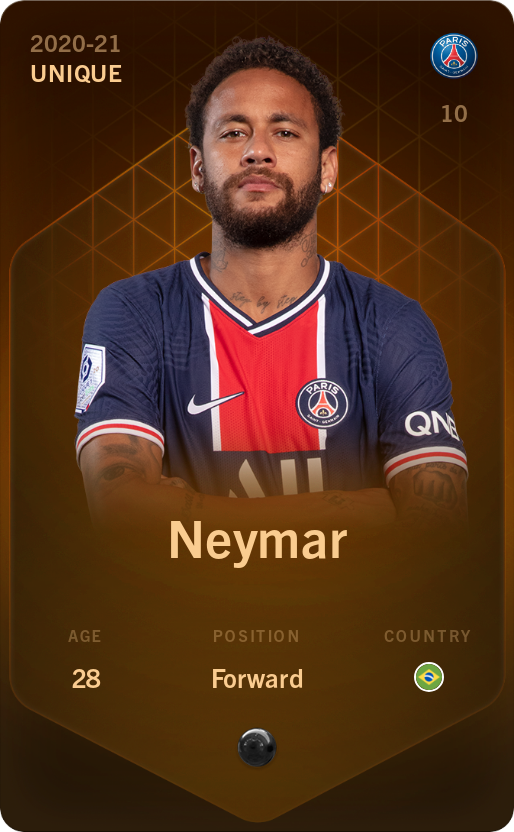
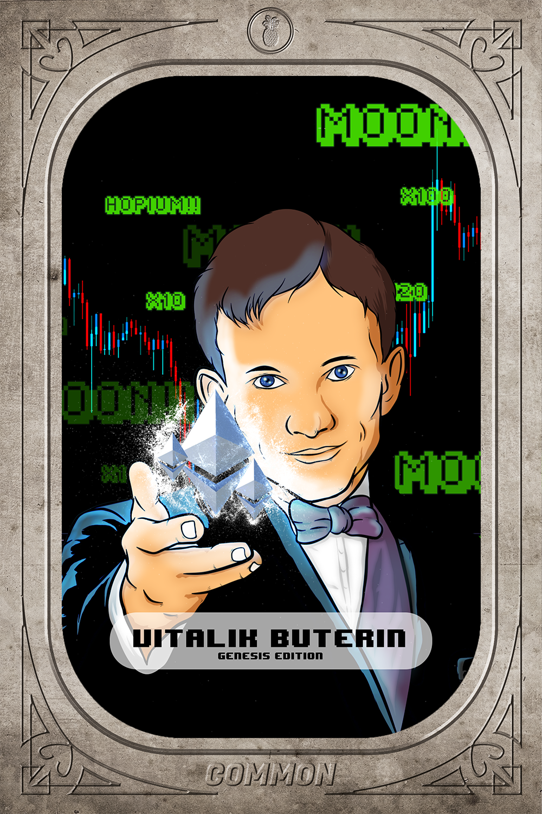
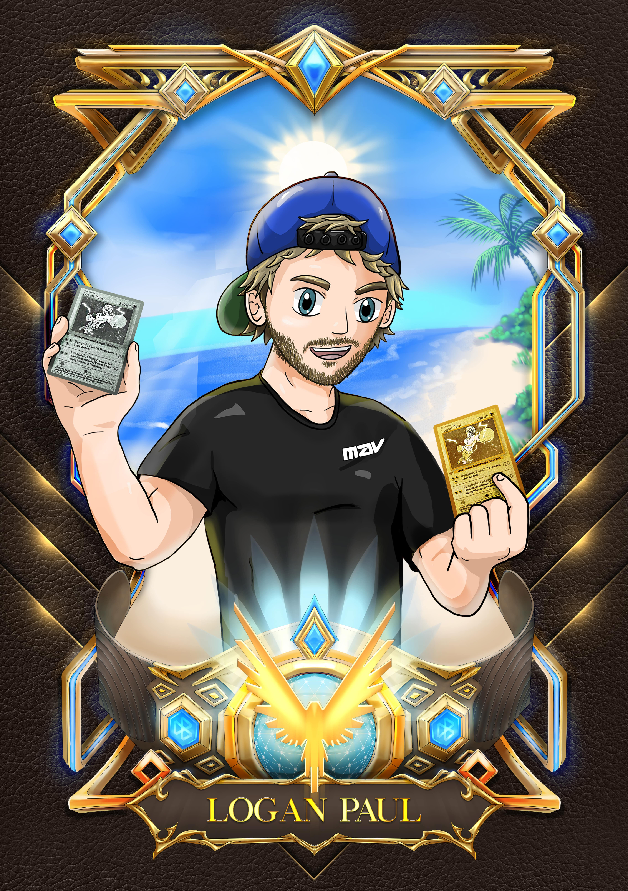
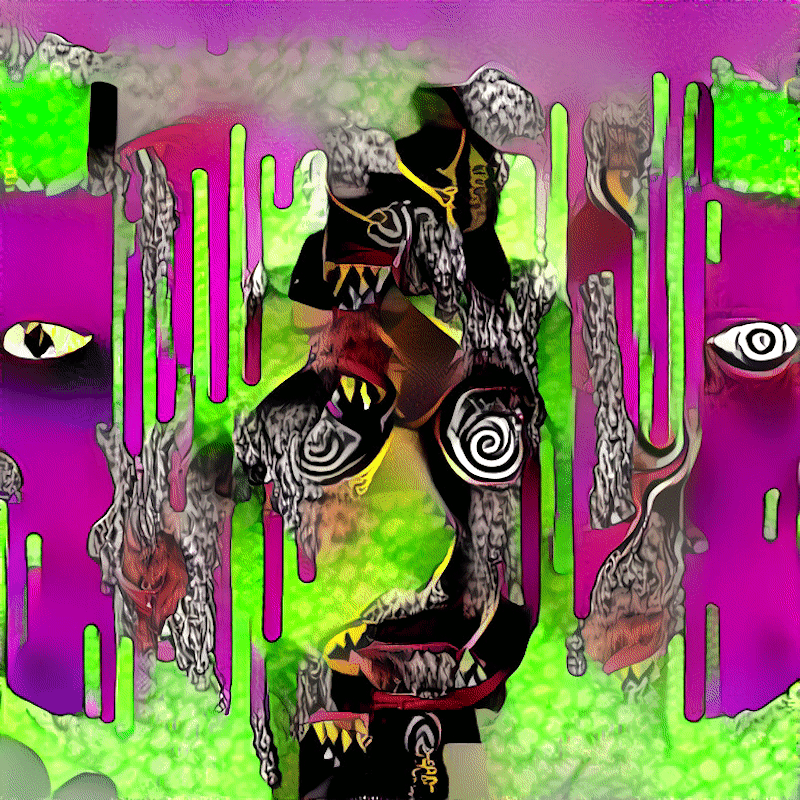

<div align="center">


# Athene.io — AtheneNFT

**A SwiftUI iOS app for discovering, sharing, and collecting NFTs.**

[](https://github.com/L0-t-0ulz/Athene.io/actions/workflows/objective-c-xcode.yml)
[](https://github.com/orgs/L0-t-0ulz/projects/2)
[](#building--running)
[](#copyright-licensing--legal-notice)

*All rights reserved. Any use of this code or artwork requires **written permission** — see
[Copyright, Licensing & Legal Notice](#copyright-licensing--legal-notice).*

</div>

---

## Table of contents

1. [About](#about)
2. [Current status](#current-status)
3. [Feature tour](#feature-tour)
4. [Visual gallery — all app artwork](#visual-gallery--all-app-artwork)
5. [Architecture](#architecture)
6. [Data models](#data-models)
7. [Service layer & API contract](#service-layer--api-contract)
8. [Testing](#testing)
9. [Security posture](#security-posture)
10. [Roadmap & issue tracker](#roadmap--issue-tracker)
11. [Building & running](#building--running)
12. [Contributing](#contributing)
13. [Copyright, Licensing & Legal Notice](#copyright-licensing--legal-notice)

---

## About

**AtheneNFT** is a social-feed style NFT marketplace app for iPhone and iPad, built entirely with
native SwiftUI — **zero third-party dependencies** (no SPM packages, no CocoaPods). It presents
NFTs the way a social app presents posts: a trending home feed, category-driven discovery with
search, an upload/share flow with live camera capture, wallet-to-wallet NFT transfer,
notifications, and a collector profile.

| | |
|---|---|
| **Platform** | iOS 17.0+, iPhone & iPad |
| **Language / UI** | Swift 5, SwiftUI (forced dark mode), Combine, UIKit interop |
| **Dependencies** | None — pure first-party frameworks |
| **Bundle ID** | `com.zayankhan12.AtheneNFT` |
| **Codebase** | ~6,700 lines of Swift across the app, unit tests, and UI tests |
| **Supported chains (model level)** | Ethereum, Solana, Polygon, BNB Smart Chain, Tezos |

## Current status

> **UI prototype with a mocked data layer.** Every screen is fully built and navigable, but all
> data comes from deterministic mock generators inside `NFTService`, behind artificial network
> latency (`MockLatency`), so the app behaves like it is talking to a live API. There is **no real
> backend yet**: `NetworkConfig.baseURL` is the placeholder `https://api.yourbackend.com` and the
> auth token is a documented placeholder that must move to the Keychain
> (`Services/NFTService.swift`). Building the real, secure backend is the focus of the
> [120-issue secure-backend backlog](https://github.com/orgs/L0-t-0ulz/projects/2).

## Feature tour

### 🏠 Home — trending feed
Social-post style feed of trending NFTs (`Core/Home/HomeView.swift`, with `NFTPostView` cards):
artwork, creator handle and avatar, like counts with animated like button, price in ETH, and
press-bounce interactions. Backed by the (mocked) `GET /nfts/trending` endpoint.

### 🔍 Discover — categories & search
The largest screen in the app (`Core/Discover/DiscoverView.swift`): category chips
(**Trending, New, Cards, Celebrities, Doge, GIFs** — each backed by artwork in the
[gallery](#visual-gallery--all-app-artwork)), a searchable NFT grid (`SearchView` with loading and
no-results states), creator circles (`UserCircleView`), and rich card presentations
(`NFTCardView`, `NFTArtCard`, `NFTGridCard`, `NFTImageCard`). Search targets the (mocked)
`GET /nfts/search` endpoint.

### 📤 Share — mint, camera & wallet transfer
Create and send NFTs (`Core/Share/`):
- **ShareView / ShareViewModel** — the mint form: pick a photo or capture one, set title,
  description, and price; upload progress is streamed to the UI (currently simulated).
- **CameraView** — AVFoundation capture session with permission handling and a live preview feed.
- **WalletTransferView / NFTTransferDetailView** — send an NFT to another wallet address, with a
  transfer-detail review step before confirming.
- **ForYouView** — a personalized-feed concept screen (currently not wired into the build target).

### 🔔 Notifications
Likes, follows, sales, and transfer alerts (`Core/Notifications/NotificationsView.swift`) from the
(mocked) `GET /notifications` endpoint, with per-item read state via
`POST /notifications/{id}/read`.

### 👤 Profile
Collector profile (`Core/Profile/ProfileView.swift`): stats row (items / followers / following via
`StatView`), owned-NFT grid (`NFTGridItemView`) with shimmer loading placeholders (`ShimmerView`),
a settings screen (`SettingsView`), and an NFT detail view with attribute/property chips
(`NFTDetailView`, `PropertyView`).

## Visual gallery — all app artwork

Every image asset shipped in the app (`AtheneNFT/AtheneNFT/Assets.xcassets/`), in detail.

### App icon

The Athene owl emblem, provided in all 13 iOS icon resolutions (20pt → 1024pt marketing).

| | |
|:---:|:---|
|  | **`AppIcon-1024.png`** — 1024×1024 App Store marketing icon. The same artwork backs `AppIcon-180/167/152/120/87/80/76/60/58/40/29/20.png` for home screen, Spotlight, and Settings on iPhone and iPad. |

### Trending — home-feed artwork (`Trending.imageset`)

Feature artwork used by the Home tab's trending feed cards and the Trending discovery category.

|  |  |  |
|:---:|:---:|:---:|
| `Image@19.png` — trending drop #1 | `Image@20.png` — trending drop #2 | `Image@21.png` — trending drop #3 |

### Cards — collectible card art (`Cards.imageset`)

Artwork for the "Cards" discovery category — trading-card style collectibles.

|  |  |  |
|:---:|:---:|:---:|
| `Image@9.png` — card series art #1 | `Image@10.png` — card series art #2 | `Image@12.png` — card series art #3 |

### Celebrities — celebrity category art (`Celebrities.imageset`)

Photographic artwork backing the "Celebrities" discovery category.

|  |  |  |
|:---:|:---:|:---:|
| `Image@2.jpg` — celebrity collection #1 | `Image@4.jpg` — celebrity collection #2 | `Image@5.jpg` — celebrity collection #3 |

### Doge — meme collection art (`Doge.imageset`)

The doge-themed meme NFT collection shown in Discover.

|  |  |  |
|:---:|:---:|:---:|
| `Image@15.png` — doge #1 | `Image@16.png` — doge #2 | `Image@17.png` — doge #3 |

### GIFs — animated category art (`Gifs.imageset`)

Artwork for the "GIFs" discovery category (stored as stills).

|  |  |  |
|:---:|:---:|:---:|
| `Image@1.png` — animated series #1 | `Image@3.png` — animated series #2 | `Image@6.png` — animated series #3 |

### New drops & profile

|  |  |
|:---:|:---:|
| `New.imageset/Image@24.png` — "New" category hero artwork | `Profile.imageset/profile@image.png` — default profile avatar |

## Architecture

```
AtheneNFT/
├── AtheneNFT.xcodeproj
├── build.swift                    # lists project Swift files (sanity helper)
├── clean_build.sh                 # wipes DerivedData + build/ and runs xcodebuild clean
├── AtheneNFT/
│   ├── AtheneNFTApp.swift         # entry point, forced dark mode, FontManager
│   ├── Core/
│   │   ├── MainTabView.swift      # 5-tab shell with custom tab bar
│   │   ├── Home/HomeView.swift            # trending feed (NFTPostView)
│   │   ├── Discover/DiscoverView.swift    # categories, search, grids
│   │   ├── Discover/NFTCardView.swift     # rich NFT card
│   │   ├── Discover/NFTArtCard.swift      # card variant
│   │   ├── Share/ShareView.swift          # mint form
│   │   ├── Share/ShareViewModel.swift     # upload state machine
│   │   ├── Share/CameraView.swift         # AVFoundation capture
│   │   ├── Share/WalletTransferView.swift # wallet-to-wallet send
│   │   ├── Share/NFTTransferDetailView.swift
│   │   ├── Share/ForYouView.swift         # personalized feed concept
│   │   ├── Notifications/NotificationsView.swift
│   │   └── Profile/ProfileView.swift      # stats, grid, settings, detail
│   ├── Models/NFT.swift           # NFT, User, Collection, Notification + enums
│   ├── Services/NFTService.swift  # API client layer (all endpoints mocked)
│   ├── Utils/                     # image loading, fallback async images, fonts
│   └── Assets.xcassets/           # all artwork shown in the gallery above
├── AtheneNFTTests/                # unit tests: models, service, share view model
└── AtheneNFTUITests/              # UI smoke tests
```

- **Pattern:** Model–View with `ObservableObject` view models; state flows through Combine
  publishers from `NFTService` into the views.
- **Data flow:** View → ViewModel → `NFTService` → `AnyPublisher` → view state. Mock responses are
  generated in-process behind `MockLatency` delays so the UI exercises real async paths.
- **Fonts & sizing:** central `FontManager` (in `AtheneNFTApp.swift`) plus dynamic sizing helpers,
  keeping typography and layout consistent across screens.
- **Planned backend:** Node.js/Express + MongoDB implementing the
  [API contract](#service-layer--api-contract), with MetaMask / Sign-In-With-Ethereum
  authentication — tracked issue-by-issue on the
  [project board](https://github.com/orgs/L0-t-0ulz/projects/2).

## Data models

Defined in `AtheneNFT/AtheneNFT/Models/NFT.swift`:

| Model | Key fields | Notes |
|---|---|---|
| **`NFT`** | `id`, `title`, `description`, `imageURL`, `price`, `creator`, `createdAt`, `blockchain`, `contract`, `tokenId`, `isLiked`, `likeCount`, `isCollected` | `Identifiable, Codable, Hashable`; helpers for formatted price, validated image URL, and "new drop" detection |
| **`User`** | `id`, `username`, `displayName`, `profileImage`, `bio`, `location`, `followerCount`, `followingCount`, `isFollowing`, `isVerified` | Helpers for display username, initials, validated avatar URL |
| **`BlockchainType`** | `ethereum`, `solana`, `polygon`, `bsc`, `tezos` | `Codable` enum with display names |
| **`NotificationType`** | `like`, follow, sale, transfer, … | Drives the Notifications feed rendering |
| **`NFTItem`** | lightweight display model | Used by grid/sample presentations |

## Service layer & API contract

`AtheneNFT/AtheneNFT/Services/NFTService.swift` is the single API client (`ObservableObject`):

- **`NetworkConfig`** — central backend configuration: `baseURL` (placeholder
  `https://api.yourbackend.com`) and `shareBaseURL` (placeholder share-link domain). The auth
  token is documented to move to the **Keychain** once real auth exists.
- **Response envelopes** — `APIResponse<T>` and `PaginatedResponse<T>` wrap all payloads;
  `CreateNFTRequest`, `LikeResponse`, `FollowResponse` model the mutations.
- **`NFTServiceError`** — typed error surface (`LocalizedError`) for the UI.
- **`MockLatency`** — artificial delays so mocked responses exercise real async code paths.

The client defines this 10-endpoint contract; the real server must implement it:

| Method | Endpoint | Purpose |
|---|---|---|
| GET | `/nfts/trending` | Trending feed |
| GET | `/nfts/user/{userId}` | NFTs owned by a user |
| GET | `/nfts/search` | Search NFTs |
| POST | `/nfts/create` | Mint/upload a new NFT |
| POST | `/nfts/{id}/like` | Like an NFT |
| POST | `/nfts/{id}/unlike` | Remove a like |
| POST | `/users/{id}/follow` | Follow a user |
| POST | `/users/{id}/unfollow` | Unfollow a user |
| GET | `/notifications` | Notification feed |
| POST | `/notifications/{id}/read` | Mark notification read |

## Testing

| Target | Coverage |
|---|---|
| `AtheneNFTTests/ModelTests.swift` | Model decoding, helpers, and invariants |
| `AtheneNFTTests/NFTServiceTests.swift` | Service-layer behavior against the mock data layer |
| `AtheneNFTTests/ShareViewModelTests.swift` | Upload/mint state machine |
| `AtheneNFTUITests/SmokeTests.swift` | End-to-end UI smoke pass |

The [secure-backend backlog](#roadmap--issue-tracker) expands this substantially: a
docker-compose **sandbox environment** ([`TEST-001` #1](https://github.com/L0-t-0ulz/Athene.io/issues/1))
serving all 10 endpoints with seeded fixtures, integration and security test suites, and CI
enforcement — because **every ticket in this project requires sandbox test evidence before it can
be approved**.

## Security posture

This project treats backend security as a first-class deliverable. Known gaps are tracked openly
as epics on the [kanban board](https://github.com/orgs/L0-t-0ulz/projects/2):

- Placeholder credentials/URLs in source → [`CFG` epic #117](https://github.com/L0-t-0ulz/Athene.io/issues/117)
- No Keychain/token lifecycle yet → [`AUTH` epic #112](https://github.com/L0-t-0ulz/Athene.io/issues/112)
- No certificate pinning / explicit ATS policy → [`NET` epic #113](https://github.com/L0-t-0ulz/Athene.io/issues/113)
- Unvalidated uploads and inputs → [`VAL` epic #116](https://github.com/L0-t-0ulz/Athene.io/issues/116)
- No real server (authz, rate limiting, injection defenses all pending) → [`SRV` epic #115](https://github.com/L0-t-0ulz/Athene.io/issues/115)

Please report suspected vulnerabilities privately to the [owner](#contact-for-permissions--inquiries)
rather than in public issues.

## Roadmap & issue tracker

All engineering work is tracked on the
**[Athene.io kanban board](https://github.com/orgs/L0-t-0ulz/projects/2)** — a
**120-issue secure-backend backlog** (110 fix issues `#1–#110` + 10 tracking epics), focused
exclusively on building and hardening the backend. No frontend tickets by design.

| Epic | Track | Issues |
|---|---|---|
| [#111](https://github.com/L0-t-0ulz/Athene.io/issues/111) `TEST` | Sandbox & test infrastructure — root prerequisite [`TEST-001` #1](https://github.com/L0-t-0ulz/Athene.io/issues/1) | 10 |
| [#112](https://github.com/L0-t-0ulz/Athene.io/issues/112) `AUTH` | Authentication, Keychain, sessions, SIWE wallet login | 14 |
| [#113](https://github.com/L0-t-0ulz/Athene.io/issues/113) `NET` | Transport security: ATS/TLS, pinning, signing, replay protection | 10 |
| [#114](https://github.com/L0-t-0ulz/Athene.io/issues/114) `API` | API-client hardening in `NFTService` | 14 |
| [#115](https://github.com/L0-t-0ulz/Athene.io/issues/115) `SRV` | Backend server build & security (authz/IDOR, rate limiting, injection, secrets) | 20 |
| [#116](https://github.com/L0-t-0ulz/Athene.io/issues/116) `VAL` | Input validation & data handling | 12 |
| [#117](https://github.com/L0-t-0ulz/Athene.io/issues/117) `CFG` | Secrets & configuration | 8 |
| [#118](https://github.com/L0-t-0ulz/Athene.io/issues/118) `LOG` | Error handling & logging hygiene | 7 |
| [#119](https://github.com/L0-t-0ulz/Athene.io/issues/119) `HYG` | Dead code & repository hygiene | 8 |
| [#120](https://github.com/L0-t-0ulz/Athene.io/issues/120) `CI` | CI/CD security & enforcement | 7 |

**Sandbox approval gate:** every ticket carries a mandatory
*"Approval gate — sandbox verification"* section — no ticket may be approved or closed without
sandbox test evidence attached (reproduced before the fix, verified after it).

The historical single-file debug board lives in [`KANBAN.md`](KANBAN.md) (`ATH-###` cards);
agent/developer conventions live in [`CLAUDE.md`](CLAUDE.md).

## Building & running

```bash
git clone https://github.com/L0-t-0ulz/Athene.io.git
cd Athene.io/AtheneNFT
open AtheneNFT.xcodeproj
```

1. Requires **Xcode 15+** and an **iOS 17** simulator or device.
2. Select the `AtheneNFT` scheme and run (`⌘R`). No dependency installation is needed.
3. Run tests with `⌘U` (unit + UI test targets).
4. To reset a broken build: `./clean_build.sh`.

CI builds and analyzes the app on every push and pull request via
[`objective-c-xcode.yml`](.github/workflows/objective-c-xcode.yml).

## Contributing

> Contributing to this repository does not grant you any rights to reuse its code or assets
> elsewhere — see the [legal notice](#copyright-licensing--legal-notice).

1. Pick a ticket from the [kanban board](https://github.com/orgs/L0-t-0ulz/projects/2)
   (`Todo` column) and move it to `In Progress`.
2. Branch from the default branch; keep changes scoped to the ticket.
3. **Sandbox evidence is mandatory:** before a ticket can be approved, attach sandbox run
   output/test evidence to the issue — reproduce the problem in the sandbox first, then show it
   fixed. Tickets without evidence will not be merged.
4. Open a PR referencing the issue (`Fixes #NN`); it must pass the CI build.

## Copyright, Licensing & Legal Notice

**Copyright © 2026 L0-t-0ulz · Zayan Khan. All rights reserved.**

This repository — including all source code, application design, UI/UX, artwork, images, icons,
animations, brand assets, product names, and documentation contained herein (collectively, the
"Work") — is the proprietary property of the copyright holder. It is made visible on GitHub for
reference, evaluation, and collaboration **within this project only**.

### No license is granted

Viewing this repository does **not** grant you any rights under copyright. Without **prior
written permission** obtained directly from the copyright holder, you may **not**:

- copy, reproduce, or redistribute the Work or any part of it;
- modify, translate, or create derivative works from it;
- use the source code, artwork, or branding in your own projects, products, or services
  (commercial **or** non-commercial);
- sell, sublicense, rent, or otherwise commercialize it;
- mint, tokenize, or resell any of the artwork as NFTs or otherwise;
- train, fine-tune, or ground machine-learning models or datasets on the Work.

### Licensing — you must contact the owner

**All licensing and permission requests must be made by contacting the owner directly**
(see [contact](#contact-for-permissions--inquiries) below). No other channel — including forks,
stars, issues, or PRs — constitutes permission. A request should include:

1. who you are (name / organization),
2. exactly what part of the Work you want to use,
3. the intended use (project, product, publication), scope, and duration,
4. whether the use is commercial or non-commercial.

Permission is only valid if granted **explicitly and in writing** by the owner. Unanswered
requests are **denied by default**.

### Enforcement

**Unauthorized copying, reproduction, modification, distribution, or commercial exploitation of
this software or its artwork is strictly prohibited and will result in legal action**, including
but not limited to DMCA takedown notices to GitHub and hosting providers, and claims for damages
under applicable copyright law.

The "Athene.io" / "AtheneNFT" names, the owl emblem, and all NFT artwork shown in the
[gallery](#visual-gallery--all-app-artwork) are protected works. Third-party trademarks referenced
in this repository (Apple, Xcode, MetaMask, GitHub, etc.) remain the property of their respective
owners.

### Contact for permissions & inquiries

- **Owner:** Zayan Khan — [@ZayanKhan-12](https://github.com/ZayanKhan-12)
- **Email:** [khanzayan200@gmail.com](mailto:khanzayan200@gmail.com)
- **Organization:** [@L0-t-0ulz](https://github.com/L0-t-0ulz)

*For suspected security vulnerabilities, please use the same contact privately — do not open a
public issue.*
